# MonAI

MonAI is an expense tracker for people in Indonesia who pay with a mix of cash, bank accounts and e-wallets (GoPay, OVO, DANA, …). Logging a transaction should take under 5 seconds: type it in, scan a receipt, or write a short phrase such as `makan siang 35rb pakai gopay` and let the AI fill in the draft.

This repository is a monorepo with two apps:

| Folder | What it is | Stack |
|---|---|---|
| [`android/`](android/README.md) | The Android client | Kotlin, Jetpack Compose, Material 3, Hilt, Room, Retrofit |
| [`backend/`](backend/README.md) | The REST API | Go, Fiber v3, Uber fx, GORM, PostgreSQL 18, MinIO, Gemini |

## Screenshots

<table>
  <tr>
    <td align="center">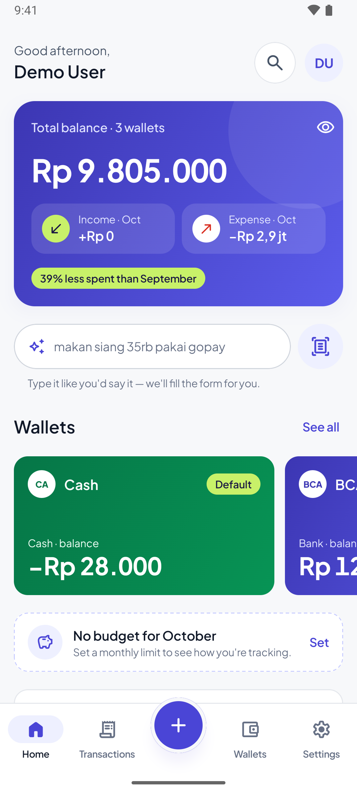<br/><sub>Home</sub></td>
    <td align="center">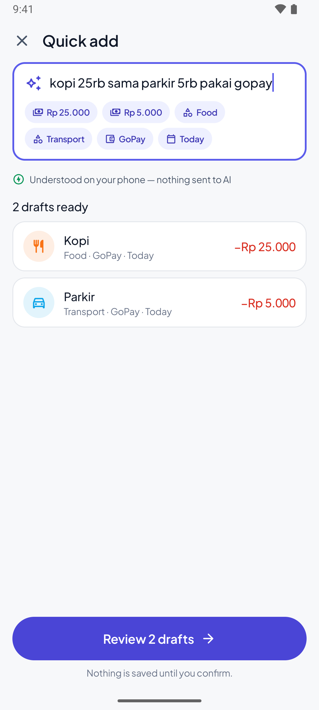<br/><sub>AI quick add</sub></td>
    <td align="center">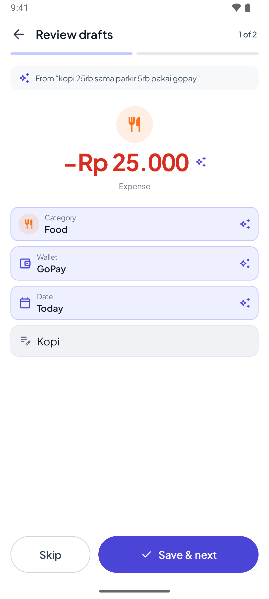<br/><sub>Review drafts</sub></td>
    <td align="center">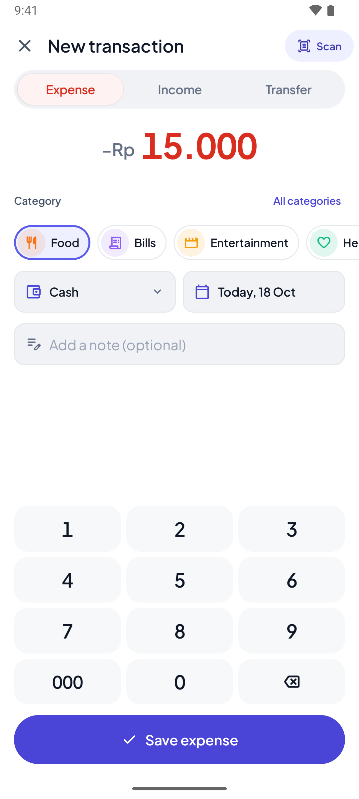<br/><sub>New transaction</sub></td>
  </tr>
  <tr>
    <td align="center">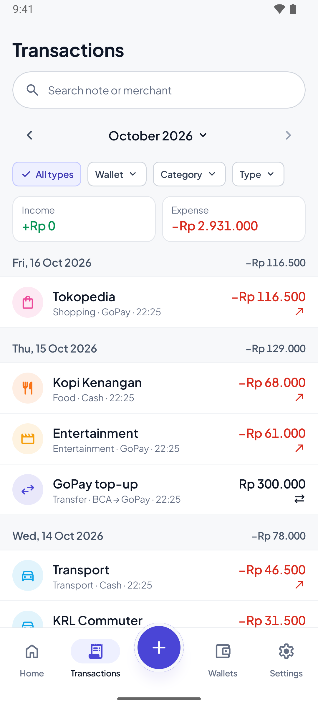<br/><sub>Transactions</sub></td>
    <td align="center">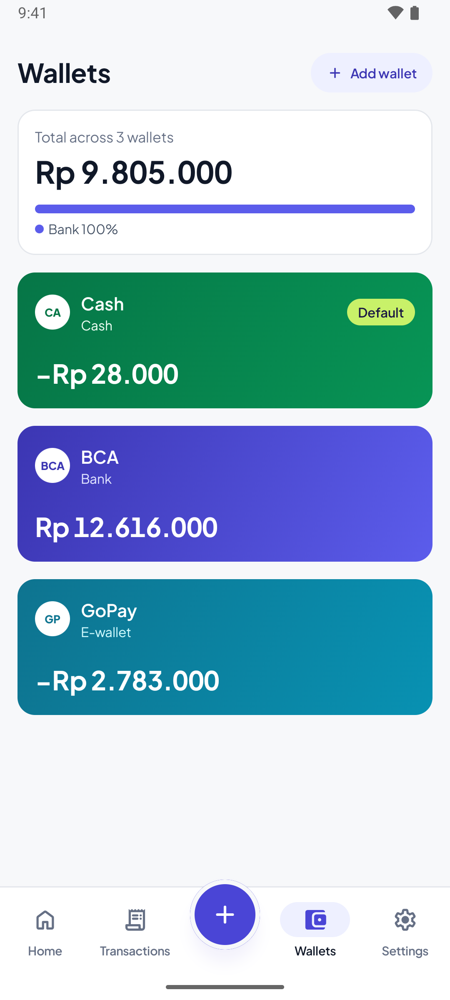<br/><sub>Wallets</sub></td>
    <td align="center">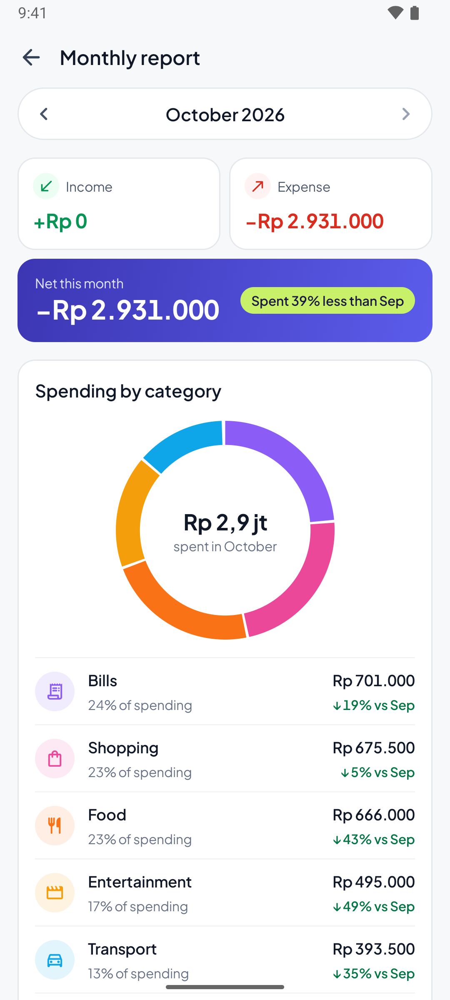<br/><sub>Monthly report</sub></td>
    <td align="center">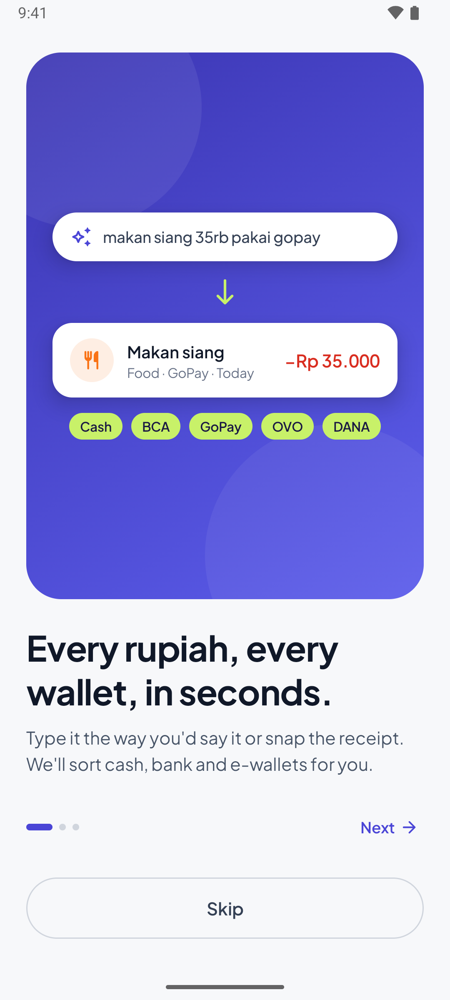<br/><sub>Onboarding</sub></td>
  </tr>
  <tr>
    <td align="center">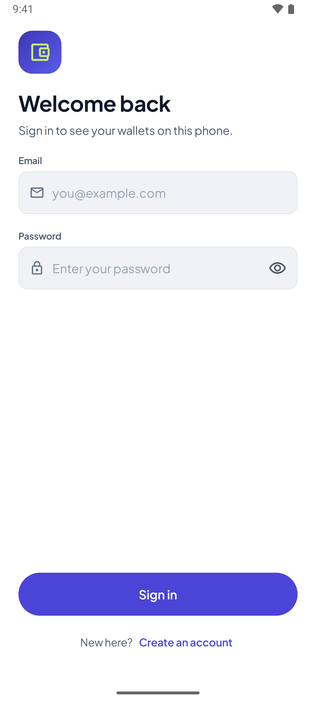<br/><sub>Sign in</sub></td>
    <td align="center">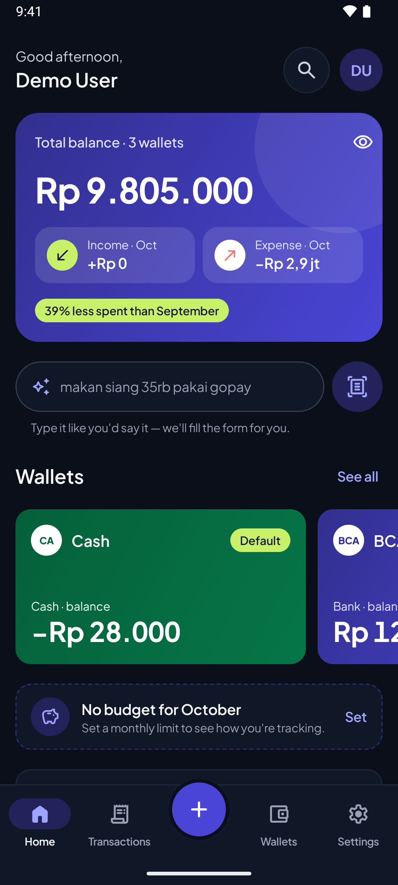<br/><sub>Home (dark)</sub></td>
    <td align="center">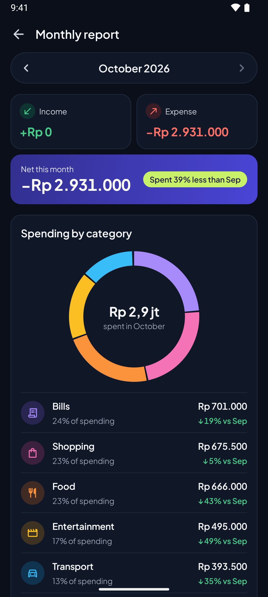<br/><sub>Monthly report (dark)</sub></td>
    <td></td>
  </tr>
</table>

## Features

- **Wallets:** cash, bank, e-wallet and other wallets, each linked to a provider from a shared catalog. Balances are always calculated from the transactions.
- **Transactions:** income, expenses and transfers, with search, cursor pagination, soft delete and restore, and receipt photos.
- **Categories and budgets:** default categories are created when you register, and you can set a monthly budget (status `OK`, `WARNING` or `EXCEEDED`).
- **Reports:** monthly totals and a breakdown by category, compared with the previous month.
- **AI quick add:** an offline parser on the phone turns a phrase into drafts as you type. When the amount or category is unclear, the backend asks Gemini.
- **Receipt scanning:** CameraX and ML Kit read the text on the phone, then the backend turns it into a draft. Nothing is saved until you confirm.
- **Auto-categorization:** checks your history first, then keywords, then the AI.
- **CSV export**, English and Indonesian UI, and offline reading from a local Room cache.
- **Admin:** role-based access control (RBAC) driven by data in the database, and a screen in Settings for managing the payment provider catalog.

## Architecture

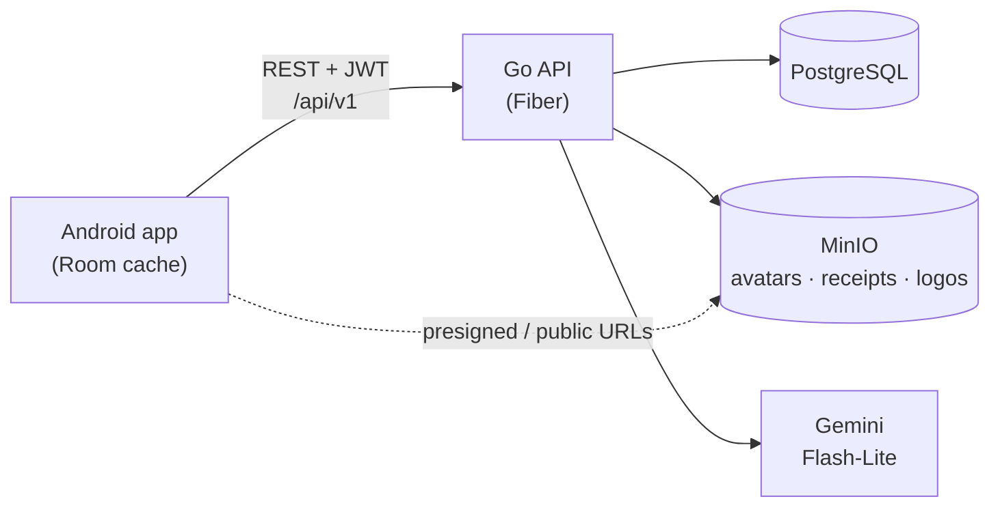

- The API is the source of truth. The app reads from its Room cache and needs a connection to create, edit or delete.
- Files (avatars, receipts, provider logos) are uploaded to the API as `multipart/form-data`. The API stores them in MinIO and returns presigned URLs that expire after 15 minutes for private files, or public URLs for provider logos.
- Only the backend calls Gemini, and it sends as little data as possible. AI endpoints return drafts only and never save anything.
- The API contract is [`backend/api/api-spec.yaml`](backend/api/api-spec.yaml) (OpenAPI 3.1). Both apps follow it.

## Quick start

You need Docker (with Compose), Go 1.27.2+, and Android Studio with an emulator.

```sh
# 1. Backend: Postgres, MinIO, migrations, API on http://localhost:8080/api/v1
cd backend
cp .env.example .env          # then fill in the passwords and secrets
docker compose -f docker-compose.dev.yml up -d monai-db minio minio-init monai-db-init
go run ./cmd/migrate up
go run ./cmd/seed             # optional: demo@monai.local / demo12345 with 3 months of data
go run ./cmd/api

# 2. Android: the dev flavor talks to the backend on your machine
cd ../android
./gradlew installDevDebug
```

See [`backend/README.md`](backend/README.md) and [`android/README.md`](android/README.md) for configuration, commands, tests and deployment.

## Repository layout

```
MonAI/
├── android/    # Android app (single :app module, package com.djtech.monai)
└── backend/    # Go API, SQL migrations, Docker Compose stacks, OpenAPI spec
```
